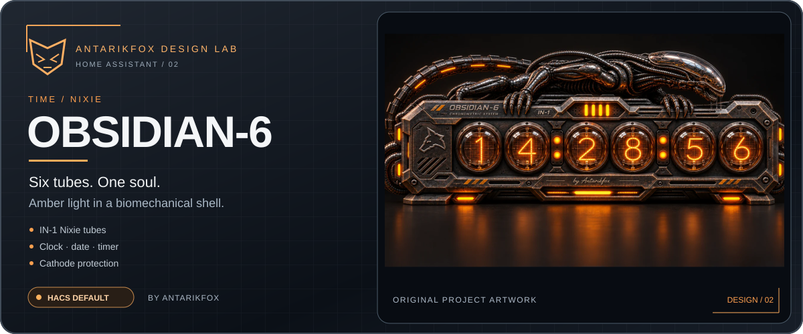
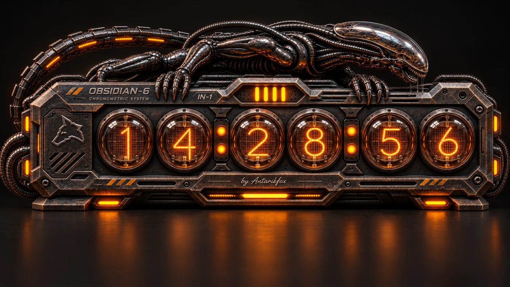

# OBSIDIAN-6 · by Antarikfox



[](https://github.com/hacs/default/blob/master/plugin)
[](https://github.com/Antarikfox/obsidian-6-card/releases/latest)
[](https://github.com/Antarikfox/obsidian-6-card/stargazers)
[](https://github.com/Antarikfox/obsidian-6-card/releases)

[](https://my.home-assistant.io/redirect/hacs_repository/?owner=Antarikfox&repository=obsidian-6-card&category=plugin)

<sub>Download counts refer to GitHub release assets, not unique HACS installs.</sub>

[Русский](README.ru.md)



A six-tube IN-1 Nixie clock with amber illumination and a static biomechanical case. Available as a Home Assistant dashboard card and a standalone offline HTML file.

## OBSIDIAN-6 in motion



*12-second animated design tour, using the original project artwork. Not a recording of live card behavior.* [Open the animation](docs/design-lab-tour.svg) if the embedded preview is static.

## Languages

English, Russian, German, Italian, French, Simplified Chinese and Japanese. **Automatic** uses Home Assistant’s language inside the dashboard and the browser’s preferred language in the standalone page. English is the fallback for unsupported languages. To override it, tap the fox logo or **OBSIDIAN-6**, then select **Display → Language**. The selection is stored in the browser. The artwork and engraved markings are part of the image.

## Standalone

Download [OBSIDIAN-6.html](standalone/OBSIDIAN-6.html) and open it directly in a modern browser. All images and scripts are embedded.

## Home Assistant

### Home Assistant 2026.11+ (built-in Marketplace)

Open **Settings → Marketplace → Add from link**, and paste the public repository URL:

`https://github.com/Antarikfox/obsidian-6-card`

Install the **Dashboard** card and reload the browser. The Marketplace uses the bundled JavaScript release asset and usually registers the dashboard resource automatically. If dashboard resources are managed in YAML, add the resource yourself:

```yaml
url: /local/community/obsidian-6-card/obsidian-6-card.js
type: module
```

### HACS (where installed)

OBSIDIAN-6 is in the default HACS catalog. Use the My Home Assistant button above or search HACS for **OBSIDIAN-6** and select **Download**. If it is not visible yet, wait for the catalog to refresh or add the GitHub URL in HACS → **Custom repositories** with category **Dashboard**. Reload the browser after installation. HACS serves the module from `/hacsfiles/obsidian-6-card/obsidian-6-card.js` and normally adds the resource automatically.

### Manual installation

Copy [obsidian-6-card.js](dist/obsidian-6-card.js) into `/config/www/`. In **Settings → Dashboards → Resources**, add or replace the module resource with `/local/obsidian-6-card.js?v=7.6.1`. Load one OBSIDIAN-6 resource per dashboard. Reload and add:

```yaml
type: custom:obsidian-6-card
language: auto
brightness: 82
```

Set `language` to `en`, `ru`, `de`, `it`, `fr`, `zh` or `ja` to specify a card language. If several cards share a browser, set a unique `id` for each to keep their preferences separate.

**Power entity** accepts a light, switch or input boolean. **Brightness entity** accepts a dimmable light, number or input number. The 0–100% control maps to the numeric entity’s range, and 0% switches a linked light off.

## Controls

Clock, date, countdown and stopwatch. Glass reflections, textured glow and brightness can be adjusted separately. Cathode protection runs a ten-digit sweep in clock and date modes every 15 minutes while the display is lit. **Cycle cathodes** starts a manual sweep.

## License and original artwork

The **program code** is open source under the [MIT License](LICENSE) (© 2026 Antarikfox). Original clock illustrations and associated decorative images are **not** under MIT. You can install and use the original bundled clock, but do not extract or reuse the artwork independently without permission. The same applies to images embedded inside the generated JavaScript and HTML. See [Artwork Rights](ARTWORK-LICENSE.md).

## Build

Requires Node.js 22. Run `npm run build` to rebuild both entry points from `src/` and `assets/`. Run `npm test` to verify build freshness, translations and clock logic. No packages need to be installed.

[Release notes](RELEASE_NOTES.md) · [Публикация и установка (RU)](docs/PUBLISH.ru.md)

## Antarikfox Design Lab 🦊

Independent Home Assistant community projects by Antarikfox. All four repositories are listed in the default HACS catalog.

| Project | What it does |
| --- | --- |
| [Antarikfox Studio](https://github.com/Antarikfox/Antarikfox-HA-card-Studio) | Visual dashboard and glass card designer |
| **OBSIDIAN-6 (this project)** | Six-tube biomechanical Nixie clock |
| [CHRONO / 03 BIO](https://github.com/Antarikfox/antarikfox-chrono-bio-clock) | Mecha clock with amber digits and moss |
| [TITAN HATCH](https://github.com/Antarikfox/titan-climate-card) | Climate telemetry and 24-hour graphs |

[Explore Antarikfox on GitHub](https://github.com/Antarikfox) · [HACS default catalog](https://github.com/hacs/default/blob/master/plugin)
