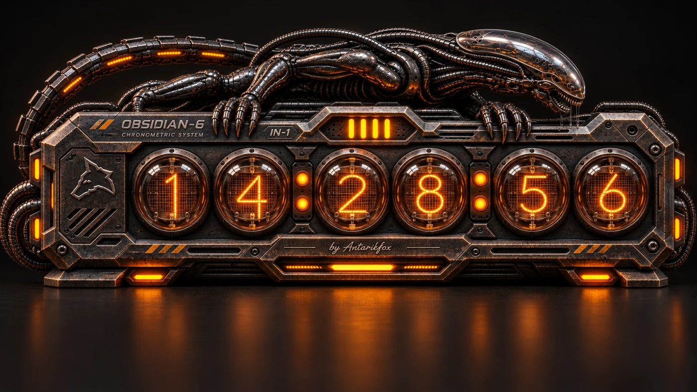

# OBSIDIAN-6 · by Antarikfox

[English](README.md)

Часы с шестью индикаторами ИН-1, янтарным свечением и статичным биомеханическим корпусом.

## Язык

Русский, английский, немецкий, итальянский, французский, упрощённый китайский и японский. В автоматическом режиме карточка берёт язык Home Assistant, а автономная страница — предпочтительный язык браузера. Для неподдерживаемых языков используется английский. Нажми на лису или надпись **OBSIDIAN-6** и поменяй язык в разделе **Отображение → Язык**. Гравировка на корпусе входит в изображение.

## Запуск

- **Браузер.** Скачай [OBSIDIAN-6.html](standalone/OBSIDIAN-6.html) и открой в браузере. Интернет для работы не нужен.
- **HACS.** Добавь репозиторий `obsidian-6-card` как пользовательский репозиторий категории **Панель / Dashboard** и установи карточку.
- **Home Assistant вручную.** Скопируй [obsidian-6-card.js](dist/obsidian-6-card.js) в `/config/www/`. В **Настройки → Панели → Ресурсы** добавь или замени модуль на `/local/obsidian-6-card.js?v=7.6.0`. Перезагрузи интерфейс. Подключай одну версию ресурса.

```yaml
type: custom:obsidian-6-card
language: auto
brightness: 82
```

Для ручного выбора в YAML допустимы `ru`, `en`, `de`, `it`, `fr`, `zh`, `ja`. Если используешь несколько карточек, задай каждой собственный `id`, чтобы их настройки хранились отдельно.

## Управление

Доступны часы, дата, таймер и секундомер. Яркость, фактуру накала и блики можно настроить отдельно. Защита катодов перебирает цифры 0–9 в режимах часов и даты примерно раз в 15 минут. Кнопка **Прогнать катоды** запускает прогон вручную. В Home Assistant можно выбрать сущности питания и яркости.

## Исходники

Для сборки нужен Node.js 22. Команда `npm run build` обновляет готовую карточку и автономную страницу. Команда `npm test` проверяет сборки, переводы и логику часов. Устанавливать зависимости не нужно.

[Чек-лист публикации](docs/PUBLISH.ru.md)
